<div align="center">

# 🌳 English Grammar Tree

### An interactive, beautifully crafted companion for mastering English grammar — from A1 all the way to C2.

[](https://english-tree-garmmar.web.app)
[](https://react.dev)
[](https://www.typescriptlang.org)
[](https://vitejs.dev)
[](https://firebase.google.com)
[](https://web.dev/progressive-web-apps/)

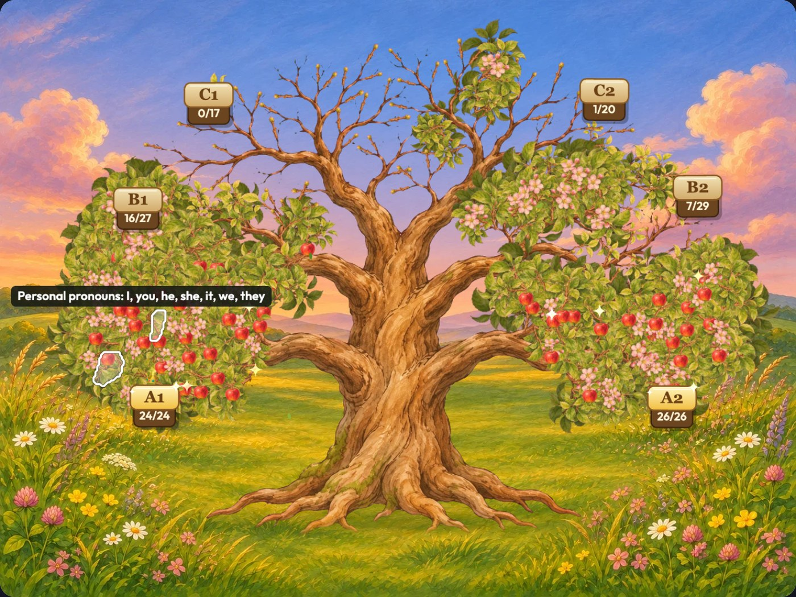

<sub><em>Your progress is a tree. It starts bare; every rule you learn puts leaves, blossom and finally an apple on its own twigs.</em></sub>

</div>

---

## ✨ Why English Grammar Tree?

Grammar textbooks are long. Apps are noisy. **English Grammar Tree** is a single, fast, focused tool that lays out the entire English grammar landscape as a tree you can climb at your own pace — with progress saved, notes, deep links, and your own personal library in the cloud.

> **Russian-first UI, multilingual core.** Originally designed for Russian-speaking learners, now localized into 🇬🇧 English, 🇷🇺 Russian, 🇩🇪 German, 🇪🇸 Spanish, 🇫🇷 French, and 🇨🇳 Chinese.

---

## 🌟 Highlights

<table>
<tr>
<td width="50%">

### 🌳 Grow your grammar tree
Daily 5-minute sessions with spaced repetition, 47 rule-linked games, streaks, badges and level exams. Your progress is a painted tree: bare at first, then every rule you learn puts leaves, blossom and finally an apple on its own twigs.

</td>
<td width="50%">

### 🏆 Compete with friends
Weekly and all-time leaderboards, friend codes and invite links, streak and XP races — with a public card you control.

</td>
</tr>
<tr>
<td width="50%">

### 📚 Complete grammar map
All CEFR levels — **A1 · A2 · B1 · B2 · C1 · C2** — with 143+ rules, examples, exceptions, common mistakes, and curated video/article links.

</td>
<td width="50%">

### 🕰 All 13 tenses, one clear tree
A decision tree guides you from "what are you trying to say?" to the right tense, backed by a visual timeline and side-by-side **tense comparisons**.

</td>
</tr>
<tr>
<td>

### 📖 Murphy companion
A dedicated **Murphy** tab mirroring the famous *English Grammar in Use* structure — every unit with its own description, progress, and notes.

</td>
<td>

### 🔗 Shareable deep links
Share a rule, a tense, or even a **selected sentence** — the recipient opens the link, the app scrolls, expands, and highlights *exactly* the passage you meant.

</td>
</tr>
<tr>
<td>

### ☁️ Account sync
Sign in with Google, GitHub, or email. Progress, notes, and pinned items sync across devices through Firestore — with a smart merge dialog on first sign-in.

</td>
<td>

### 🌗 Themes & motion
A polished **light/dark theme** (no flash on load), particle animations on rule completion, and smooth CSS transitions throughout.

</td>
</tr>
</table>

---

## 🧩 Features in detail

### 🌳 Today — practise every day and watch your tree grow

The **Today** tab (the default) turns the reference into a daily habit. A greeting card shows your 🔥 streak, the daily XP ring and your level, nudges you with what matters most right now (a streak at risk, leaves to water, XP left to the goal) and puts **one big button** in front of you: the daily session. Everything else sits behind a sticky switcher — **Tree · Games · Leaderboard · Progress · Badges**.

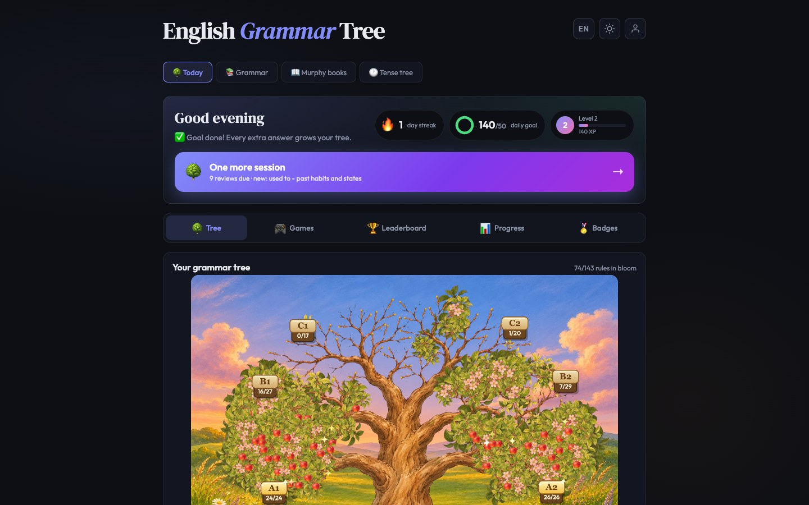

#### 🌳 The tree — your progress, painted

The tree is the heart of the app. It is not a decoration with a progress bar next to it: **the foliage itself is your progress**. A brand-new learner sees a bare winter tree; a learner who has mastered everything sees a crown heavy with apples.

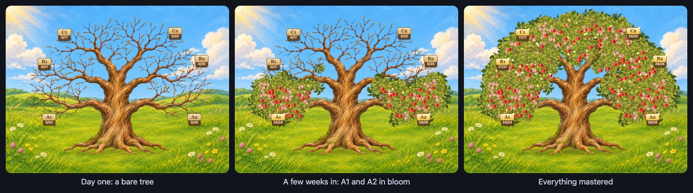

**How to read it**

| On the tree | Means |
|---|---|
| 🌰 A bud on a bare twig | You haven't started this rule |
| 🌱 A few pale young leaves | Your first correct answers |
| 🍃 A full green spray | You're learning the rule |
| 🌸 Blossom | You know it — it counts as "in bloom" |
| 🍎 An apple | Long-term memory: mastered |
| 🍂 Yellow tips | It's due for review |
| 🟡 A fully yellow spray with a red ring | A **shaky** rule: you keep getting it wrong in real use |

**How it is organised**

- A painted tree in a meadow: one limb per CEFR level, and every one of the 143 rules owns its own twigs and its own area of the crown.
- Rules follow the branch in curriculum order, so a topic fills in one sub-branch at a time and you can see where you are in a level.
- Each limb carries a wooden sign with its level and count. A level in full bloom gets extra blossom and a gold sign.
- Point at the crown to see a rule's area and name; tap it to open the rule or practise it. Every rule is also reachable by keyboard and screen reader.
- The meadow follows your clock — night, sunrise, afternoon, sunset — and the limbs sway in the wind while leaves drift down (off when *reduce motion* is on, paused when the tree is off-screen).
- **Level exams** (20 mixed questions, 80% to pass) earn a 👑 on the level's sign and a downloadable certificate.

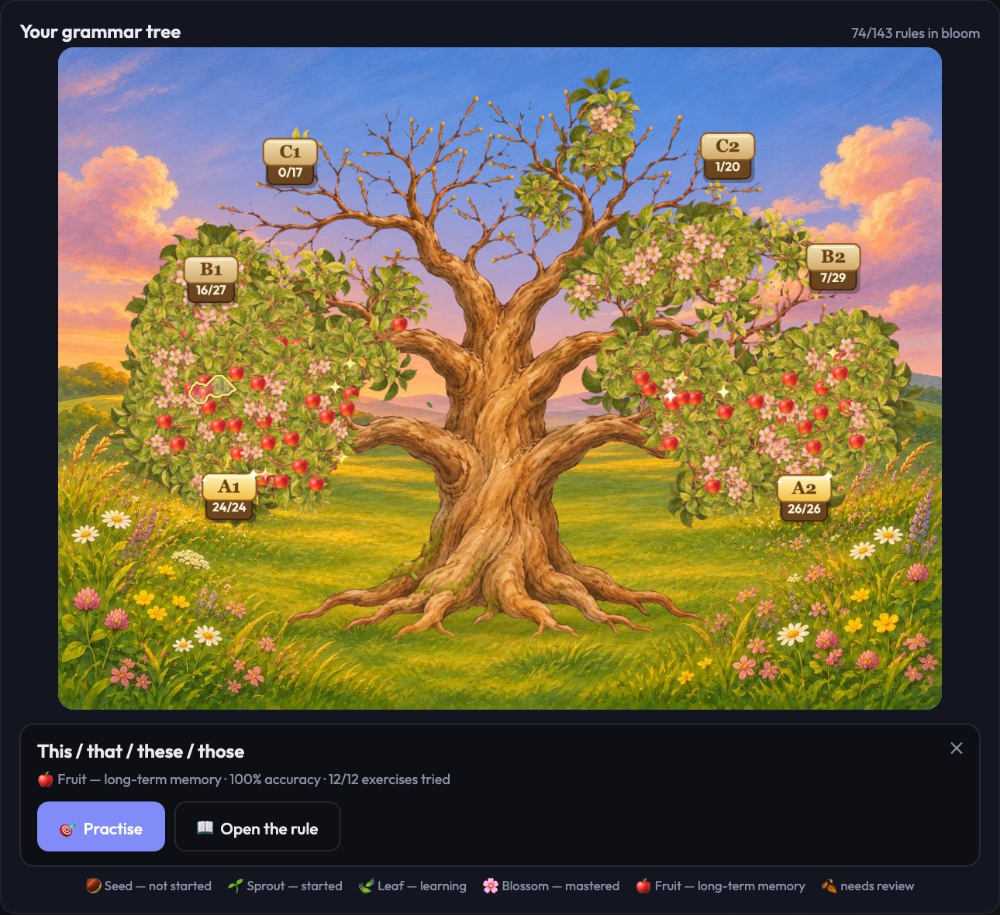

<sub><em>Tap a rule's area to see its stage, your accuracy, and buttons to practise it or open the rule.</em></sub>

The scene follows the time on your device, cross-fading over an hour at each change:

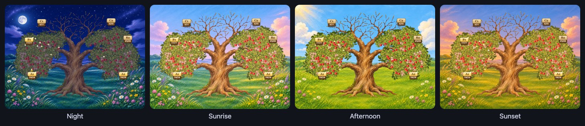

Under the hood the tree is a painting cut into a trunk and six limbs, with leaves, blossom and fruit added from painted sprites on mapped twig points. The layout is computed for however many rules a level has, so adding rules never needs new artwork.

**🎯 Learning loop**
- **Daily session** — 12 short exercises (~5 min): due reviews first, your recent mistakes, then a few items from the next new rule. Spaced repetition (Leitner boxes: 1 → 3 → 7 → 14 → 30 → 60 → 120 days) decides what comes back and when.
- **Earned mastery** — ticking a rule's ✓ starts a 5-question test-out; rules are marked done automatically once they reach 🌸.
- **Mistake deck** — every wrong answer comes back until you get it right on 3 different days.
- **Placement test** — a 5-minute adaptive test that finds your level and can mark lower levels as known.
- **Streaks with freezes, a daily XP goal, levels** and **20 badges**.

#### 🎮 Games — 47 ways to practise the same rules

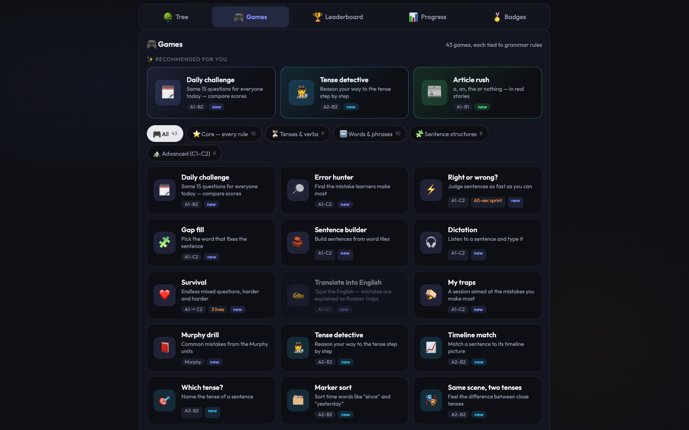

Every game is tied to grammar rules, so playing is never separate from learning: each answer moves the same spaced-repetition schedule as the daily session, earns XP towards your daily goal, and grows the same tree.

- **Recommended for you** — the daily challenge plus games at your level that you haven't tried yet.
- **Groups** — *Core* (work with every rule), *Tenses & verbs*, *Words & phrases*, *Sentence structures* and *Advanced (C1–C2)*.
- **Modes** — relaxed rounds, 60-second sprints, and survival with three lives.
- **Each card shows** the levels it covers, its mode and your best score.

A round is deliberately small: one clear task at a time, instant feedback, and an explanation when you get it wrong.

**Four games aim at the two things Russian has no equivalent for — articles and tenses:**

- 🚀 **Article blitz** — a phrase and four keys that never move (*a · an · the · ∅*), 60 seconds on the clock. A wrong pick shows its one-line reason, and the results list everything worth another look.
- 🔧 **Article repair** — a message written with no articles at all, the way a Russian speaker tends to write it. Tap a word to put an article in front of it, and leave alone the nouns that take none.
- ⚔️ **Tense duel** — one sentence, two forms, always on the same sides: Past Simple vs Present Perfect, *I live here since…*, *will* after *when / if*, and more. Tap, swipe or use the arrow keys.
- 🎬 **Story time** — short stories where every verb needs its tense chosen from the context, with a note for each gap you get wrong.

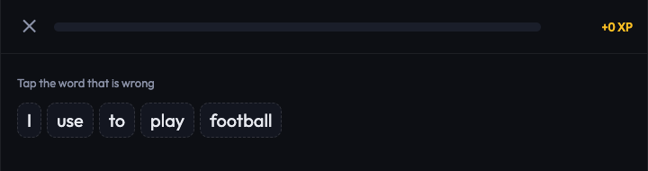

The full list: error hunter, right-or-wrong sprint, gap fill, sentence builder, dictation, survival, Murphy drill, tense detective (walk the decision tree), timeline match, marker sort, same scene/two tenses, verb forge, verb memory, article rush, preposition sort, adjective stack, number dictation, question maker, consequence match, transformer (passive), gossip chain (reported speech), verb patterns, modal detective, regret machine (wish), sentence welder (relative clauses), formalizer (inversion), spotlight (cleft), connector bridge, register slider, comma tap and more. **Challenge links** let a friend replay your exact round; the **daily challenge** gives everyone the same 15 questions.

**🏆 Leaderboard & friends** (signed-in users)
- Boards: **Friends** (sort by this week's XP, all-time XP or streak), **This week** (everyone, resets every Monday) and **All time**.
- Each row shows rank 🥇🥈🥉, avatar, name, level, live streak, mastered rules and the latest badges.
- **Add friends** by their 8-character friend code, by searching names, or with an **invite link** (`…/#friend=CODE`); accept or decline incoming requests, cancel your own, remove friends.
- **Your public card** — choose the name shown (defaults to your first name, never your email) and who sees you: **Everyone** or **Friends only**.

**🇷🇺 Built for Russian speakers**
- **Translate into English** — see a Russian sentence, type the English. Grading ignores case, punctuation, contractions and harmless synonym swaps, but not articles, auxiliaries, prepositions or word order. Mistakes are shown word by word and named as a *trap*: «В русском нет артикля…», «после when — настоящее время…». (In other UI languages the same game uses the rule examples' translations.)
- **Your traps** — every exercise is tagged with the Russian interference it tests (articles, missing *to be*, Present Perfect vs Past Simple, *will* after *when/if*, questions without *do*, prepositions, uncountables, «бы» and conditionals, reported speech, -ing vs *to*, modals, false friends, word partners, phrasal verbs, politeness). Progress shows the traps that catch you most, with one-tap sessions; daily sessions also slip in two items from your weakest trap.
- **«Почему по-русски иначе»** — on expanded rule cards: why Russian makes this rule hard, typical word-for-word mistakes (✗ *I live here since 2010* → ✓ *I have lived here since 2010*) with audio, and a button to train that trap.
- **Word traps** — false friends (*magazine ≠ магазин*), word partners (*make* vs *do*, *take a photo*), phrasal verbs and verb + preposition (*depend on*, *wait for*).
- **«Как не звучать грубо»** — turn direct Russian-style requests into natural, polite English.

**🤖 Claude connector** — connect Claude (Desktop or Claude Code) to your account with a small local program. No server and no paid plan: it runs on your computer and syncs once a day or on request. See [mcp/README.md](mcp/README.md).
- **Reads your progress** — level, streak, the stage of every rule, weakest rules and traps.
- **Corrects you in real conversations** and logs each mistake against a rule. A rule you keep breaking is marked **shaky** — even if it is ticked as done — and returns to your daily session until you get its exercises right on 3 different days.
- **Flags a rule as shaky itself** when it sees you don't really command it, with a one-line reason shown in the app.
- **Drills count as real practice** — Claude asks the app's own exercises in chat: correct answers move the rule forward on your tree, wrong ones come back for review, and a finished round counts as a session towards your daily goal and streak.

**📊 Progress** — XP per day, a 16-week activity heatmap, mastery by level (Grammar and Murphy books), your weakest rules, and practice settings (daily goal, sound, placement, reset).

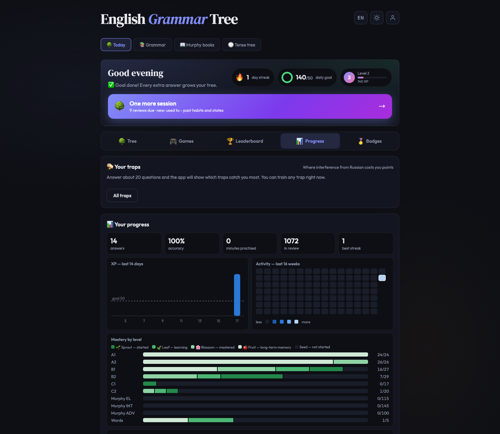

Exercises come from the existing rule content (≈1,100 common-mistake pairs and ≈300 example sentences are turned into exercises automatically) plus ≈970 hand-written drills in `app/practice/content/`.

#### 💾 How practice is saved

- **On the device:** instantly in `localStorage` (writes are coalesced per burst and flushed when the tab is hidden), so the app works fully offline.
- **In the cloud** (when signed in), at `users/{uid}/practice/state` — tuned to keep Firestore usage tiny:
  - **Reads:** one document read at sign-in, plus one when you come back to the tab after 3+ minutes (to pick up another device). No realtime listener, so your own writes never come back as reads.
  - **Writes:** only the fields that changed since the last sync (single items, days, streak…) via a merge write, debounced to one write per burst of activity (≤ every 20 s while you play), flushed at the end of each session and when the tab is hidden. A full overwrite happens only on first upload or after a reset.
  - **Merge:** per-item last-write-wins, so two devices can practise offline and sync later; a reset on one device wins over older data everywhere.
- **Public profile** (`profiles/{uid}`) is rewritten only when a shown number changes, at most every 30 s (immediately at the end of a session). Leaderboards are cached for a minute; the only live listener is on your own friend requests.

### 📐 Grammar rules — organized, expandable, searchable

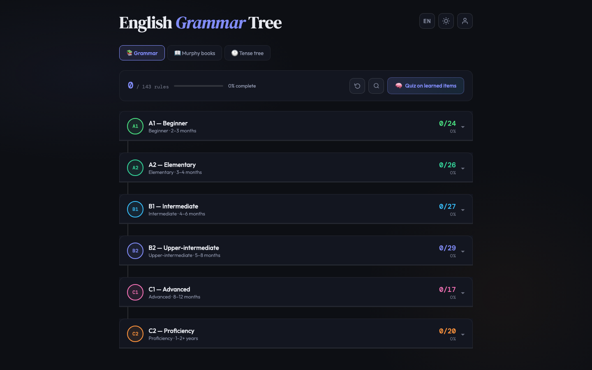

<sub><em>☀️ Light theme · 🌙 Dark theme — switch any time, stays in sync across devices.</em></sub>

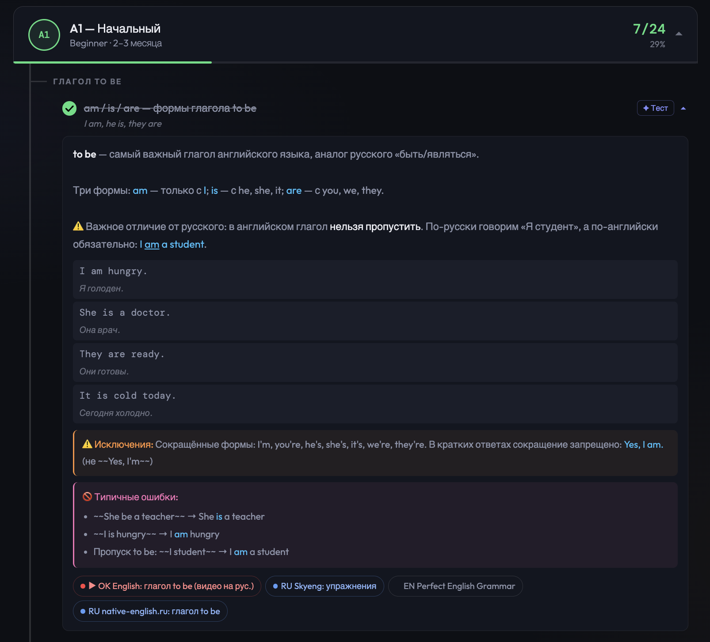

Each rule card contains everything you need in one place:

- 🧠 **Plain-language explanation** with rich HTML formatting
- ✍️ **Examples with translations** to your interface language
- ⚠️ **Exceptions** and real-world edge cases
- 🚫 **Common mistakes** Russian speakers make
- 🔗 **Reference links** — YouTube, Russian articles, English sources
- ✅ **Done / Undone** toggle with celebratory particle burst
- 📌 **Pin** important passages and leave yourself a message
- 📝 **Personal notes** attached to any selection of text

<table>
<tr>
<td width="50%">

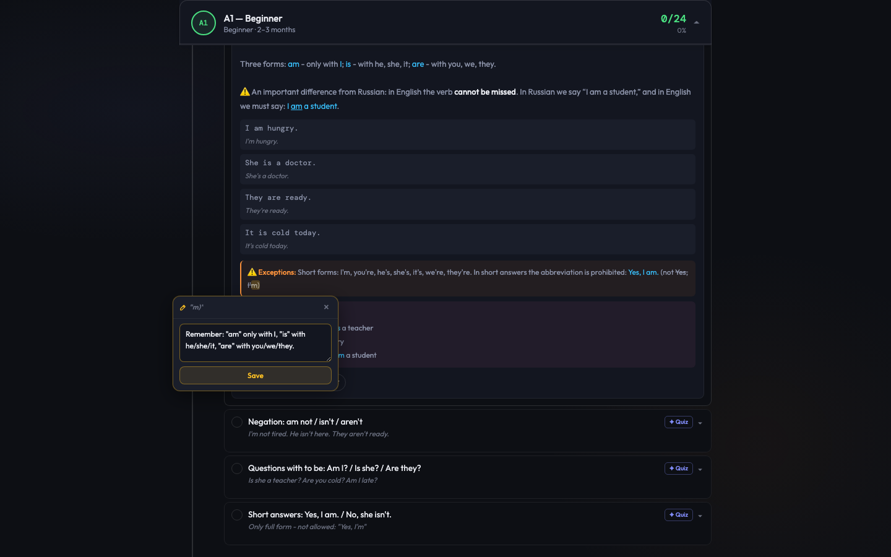

**📝 Notes** — highlight any sentence inside a rule and jot down your own reminder. Notes live on the selection itself, follow you across devices, and never clutter the main explanation.

</td>
<td width="50%">

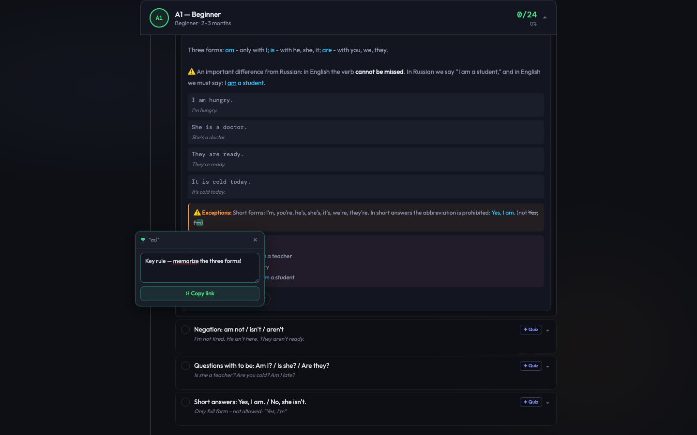

**📌 Pinned passages** — lock down the sentence that always trips you up and attach a short note. The pin sticks to the exact range, survives reloads, and is shareable.

</td>
</tr>
</table>

### 🕓 Tenses — explore, compare, understand

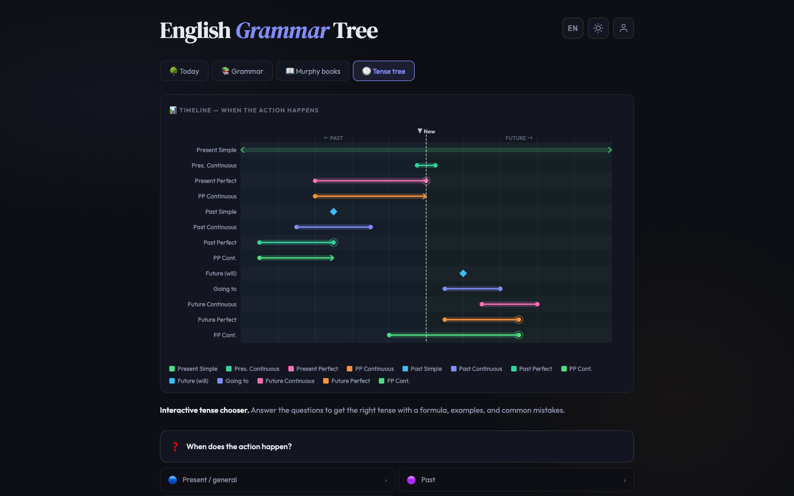

- **Timeline visualization** — see at a glance how all 13 tenses line up across past, present, and future — from Present Simple to Future Perfect Continuous
- **Interactive decision tree** — a few guided questions and you land on the right tense, with formula, examples, and pitfalls
- **Formulas, markers, examples, common mistakes** — always one tap away

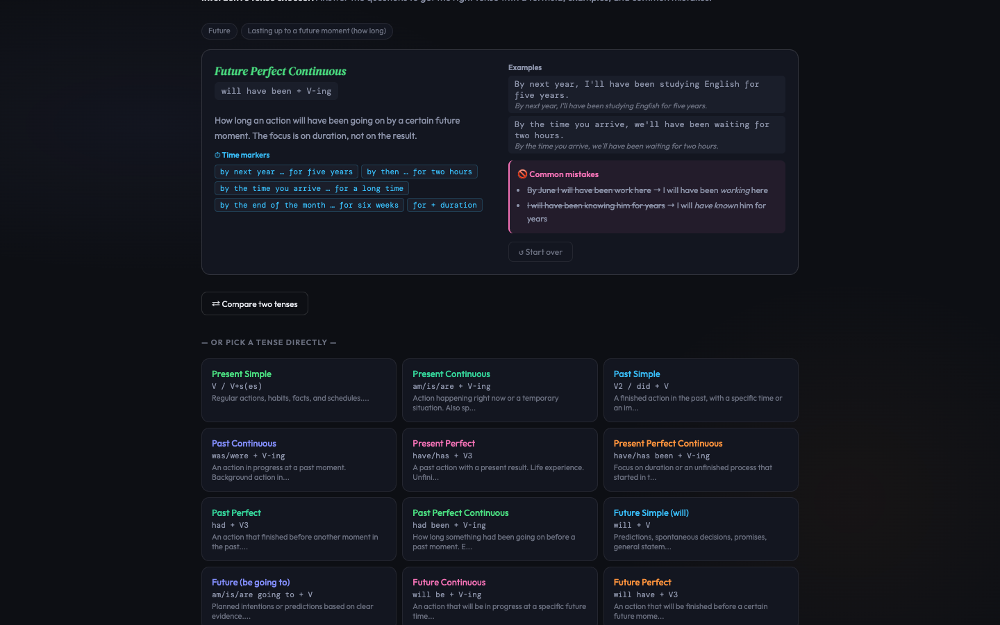

<sub><em>Every tense — including Future Perfect Continuous — ends in a card with its formula, time markers, examples and the mistakes learners make most.</em></sub>

And when two tenses feel confusingly similar, compare them side-by-side:

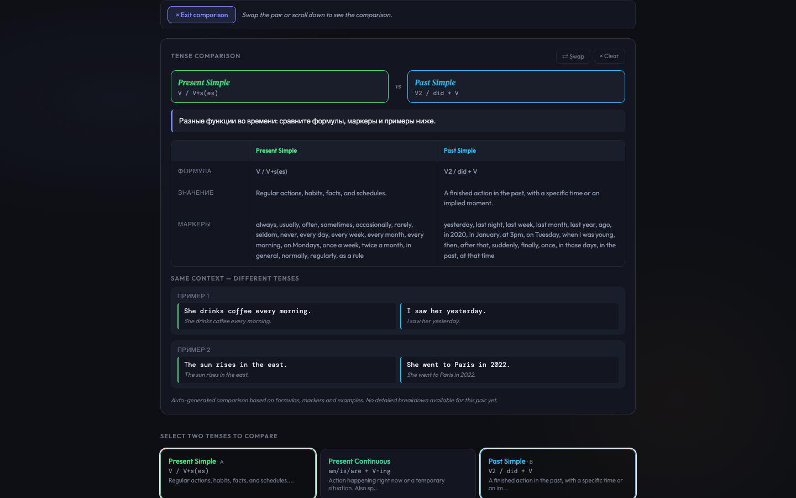

**Tense comparison** *(new!)* — pick any two tenses and the app lines up their formulas, markers, and contrasting example sentences in the same sentence context. Perfect for Present Simple vs. Present Continuous, or Past Simple vs. Present Perfect.

### 📖 Murphy companion

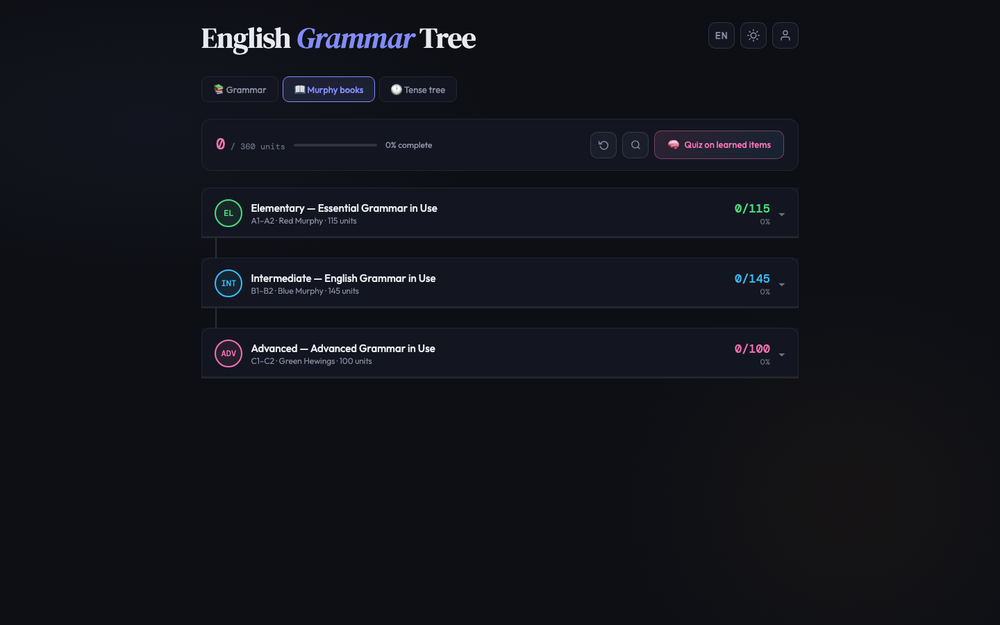

A dedicated **Murphy books** tab mirroring the canonical *English Grammar in Use* series — **Elementary**, **Intermediate**, and **Advanced Grammar in Use** — with **360+ units** in total. Each unit carries its own description, independent progress, and supports the same notes, pinning, deep linking, and AI quiz prompts as the main grammar tree.

### 🔗 Deep links — share any rule, tense, or text passage

Every grammar rule and every tense has a **share button** (⛓). But you can go further — **select any text** inside a rule and share *that specific passage*.

<table>
<tr>
<td width="50%">


**1.** Select any text inside an expanded rule.
**2.** A floating **"⛓ Share selection"** button appears.
**3.** Click — the URL with the exact text range is copied.

</td>
<td width="50%">


**4.** Recipient opens the link.
**5.** App navigates, scrolls, expands the rule.
**6.** The passage glows bright green until first interaction.

</td>
</tr>
</table>

Deep links work across all three tabs — **Grammar**, **Murphy**, and **Tenses**.

### 📊 Progress tracking

- Mark rules as **done / not done** — persisted locally and, if signed in, to the cloud
- Dashboard shows overall progress %, completed rules, and finished CEFR levels
- Separate progress tracks for **Grammar** and **Murphy**
- Reset progress at any time

### 🔍 Full-text search

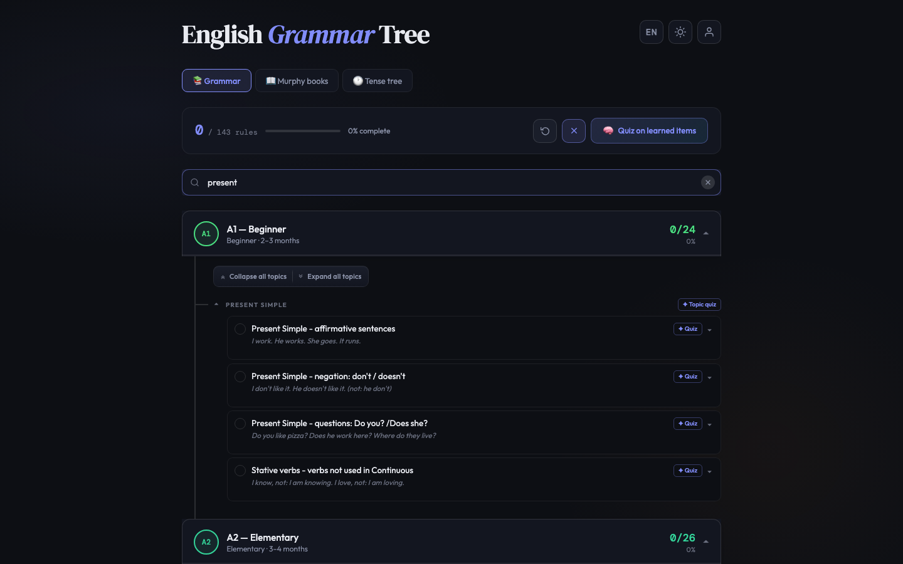

- Matches across rule titles, notes, explanations, examples, and exceptions
- Matching categories and levels **auto-expand** as you type so you see context, not just hits
- Mobile-friendly search bar that collapses gracefully on small screens

### 🤖 AI-assisted practice

- Generate a **ChatGPT / Claude-ready prompt** for any single rule, or for all rules you've completed
- One-click copy to clipboard — paste anywhere and get an instant custom quiz
- Prompts are localized to your UI language

### 🔐 Sign in & sync

<table>
<tr>
<td width="55%">

- Sign in with **Google**, **GitHub**, or **email + password**
- First-time sign-in with existing local progress? A clean **merge dialog** lets you decide what to keep
- Real-time sync to Firestore — progress, notes, pinned items, and theme
- Sign out any time without losing your local history
- Continue fully offline without an account — sync is optional

</td>
<td width="45%">

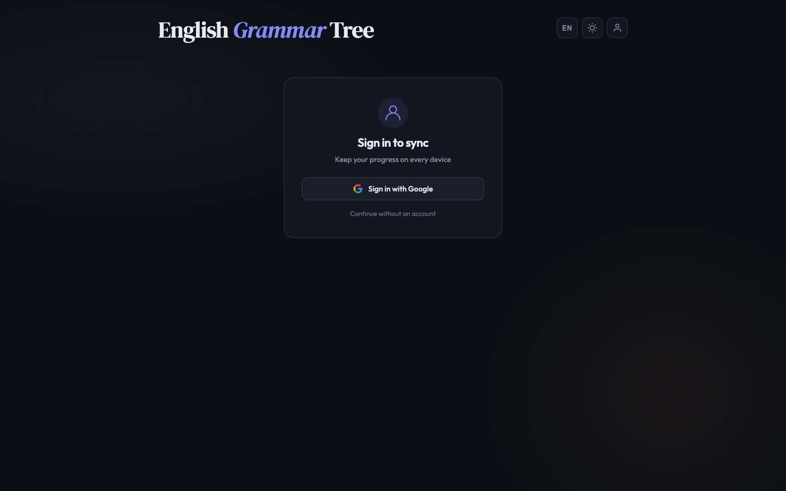

</td>
</tr>
</table>

### 🌍 Languages

<table>
<tr>
<td width="55%">

Full UI localization with i18next, covering 6 languages:

| 🇬🇧 English | 🇷🇺 Русский | 🇩🇪 Deutsch | 🇪🇸 Español | 🇫🇷 Français | 🇨🇳 中文 |
|:-:|:-:|:-:|:-:|:-:|:-:|

Translation bundles are **lazy-loaded** per language — no wasted bytes. The picker in the header switches UI, example translations, and AI quiz prompt language simultaneously.

</td>
<td width="45%">

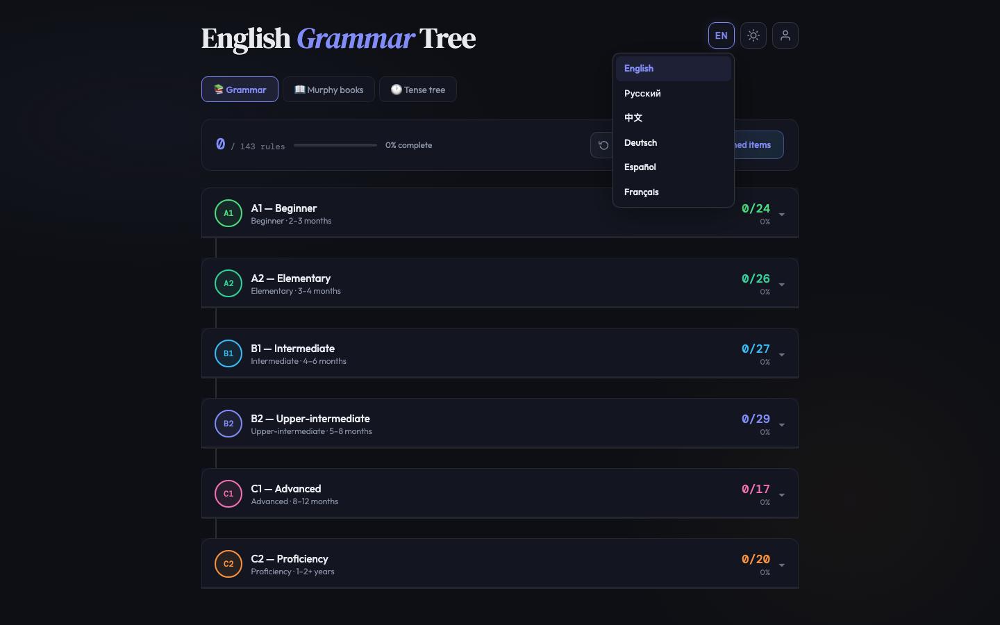

</td>
</tr>
</table>

### ⚡ Performance & offline

- **PWA** — install to home screen, works offline
- **Lazy-loaded routes** — each tab arrives only when opened
- **No flash** theming — theme class applied before first paint
- Biome-linted, tree-shaken, Vite-optimized

---

## 🛠 Tech Stack

| Layer | Technology |
|---|---|
| 🎨 UI | React 18 + TypeScript |
| ⚡ Build | Vite 6 |
| 🌐 i18n | i18next + react-i18next (6 locales, lazy loaded) |
| 🔥 Backend | Firebase Auth + Firestore |
| 📱 PWA | vite-plugin-pwa |
| 🧹 Lint / Format | Biome |
| 🪝 Git hooks | Husky + lint-staged |
| 🚀 Hosting | Firebase Hosting |

---

## 📂 Project structure

```
english-grammar-tree/
├── app/
│   ├── components/
│   │   ├── Practice/       # Today tab, tree, game runner, exercise renderers
│   │   ├── Social/         # Leaderboard, friends, public card
│   │   ├── Grammar/        # Grammar rules tab
│   │   ├── Murphy/         # Murphy companion tab
│   │   ├── Tenses/         # Tree, timeline, comparison, result
│   │   ├── Auth/           # Sign-in / sign-up screens
│   │   ├── Account/        # Account management page
│   │   ├── MergeDialog/    # Local ↔ cloud progress merge UI
│   │   └── Header/         # Search, tabs, theme toggle, language picker
│   ├── context/            # Auth + sync context providers
│   ├── data/               # Grammar, tenses, tree & timeline data
│   ├── hooks/              # useProgress, useNotes, useTheme
│   ├── practice/           # Practice engine: item index, SRS, sessions, games, sync, drill content
│   ├── social/             # Public profiles, friends, leaderboards (Firestore)
│   ├── i18n/               # Locales, AI prompt templates, rule translations
│   ├── services/           # Firestore service, sync registry
│   └── utils/              # Deep links, selection, clipboard, particles
├── mcp/                    # Local Claude connector (MCP server) — see mcp/README.md
├── public/                 # PWA assets and the tree artwork (public/tree)
├── scripts/                # Build / maintenance scripts and tests
└── screenshots/
```

---

## 🚀 Getting started

**Prerequisites:** Node.js 18+

```bash
# Install
npm install

# Develop
npm run dev

# Build
npm run build

# Deploy to Firebase (hosting + Firestore rules and indexes)
npm run deploy

# Build the local Claude connector (mcp/dist/index.js)
npm run build:mcp
```

The leaderboard and friends need the Firestore **security rules** (`firestore.rules`) and **composite indexes** (`firestore.indexes.json`) from this repo. Deploy them on their own with:

```bash
firebase deploy --only firestore:rules,firestore:indexes
```

Data model: `profiles/{uid}` (public card), `friendCodes/{CODE}` (code → uid), `friendships/{uidA_uidB}` (`pending` / `accepted`), plus private `users/{uid}/…` (progress, notes, practice state).

Other scripts:

```bash
npm run lint      # Biome lint check
npm run format    # Auto-format
npm run check     # Format + lint fix
npm run preview   # Preview production build
npm test          # Unit tests (SRS, sync diffing, social helpers, translation grading, traps, Claude connector, tree layout) + content validator + translation check
```

---

## 🧾 Data format

Grammar rules are typed and easy to extend:

```typescript
{
  id: 'a1_01',
  text: 'am / is / are — формы глагола to be',
  note: 'Short summary',
  exp: '<p>Full HTML explanation</p>',
  ex: [['I am a student.', 'Я студент.'], /* ... */],
  exc: 'Special cases and exceptions',
  mistakes: ['Common mistake description', /* ... */],
  links: [{ label: 'Video', url: '...', type: 'yt' | 'ru' | 'en' }],
  markers: { tags: ['...'], note: '...' }
}
```

---

## 📜 License

MIT — learn, fork, share.

<div align="center">

---

Made with ❤️ for English learners everywhere.
**[Try it live →](https://english-tree-garmmar.web.app)**

</div>
